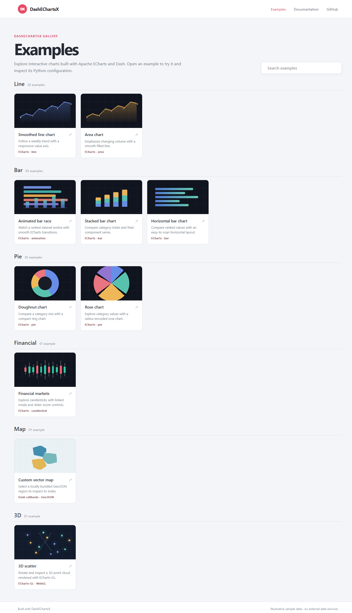
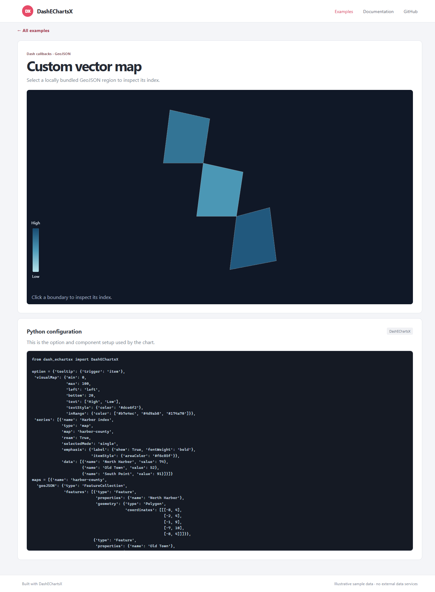
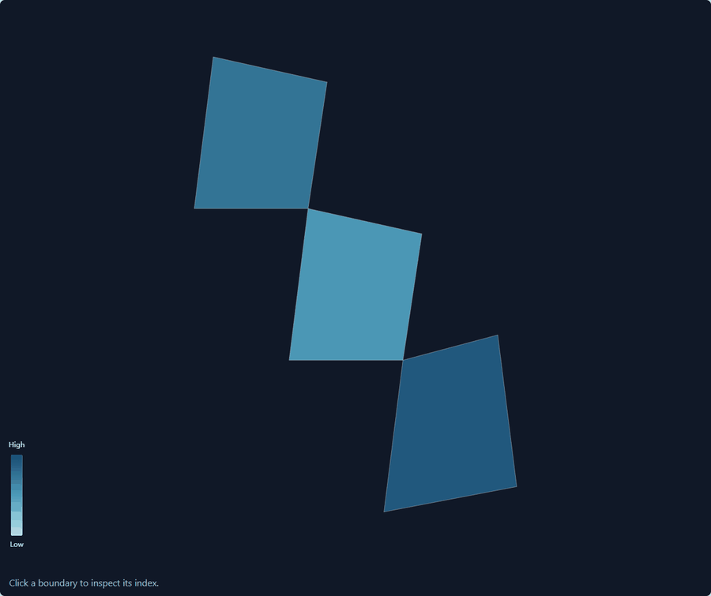

Example gallery
===============

These complete Dash applications can be run from the repository root after
installing the project with ``python -m pip install -e .``. Code blocks include
copy buttons; see the
`examples README <https://github.com/rakrsh/dash-echartsx/blob/main/examples/README.md>`_
for run commands and optional WebSocket setup.

   Browse the gallery by chart family, then open an example to inspect its
   interactive chart and Python configuration.

Financial multi-axis chart
--------------------------

Candlesticks, trading volume, and MACD share linked category axes and data
zoom.

.. literalinclude:: ../examples/financial_multi_axis.py
   :language: python
   :caption: examples/financial_multi_axis.py

Real-time streaming
-------------------

The app uses ``dcc.Interval`` by default and can consume a JSON WebSocket feed
when ``ECHARTSX_WEBSOCKET_URL`` is set.

.. literalinclude:: ../examples/realtime_streaming.py
   :language: python
   :caption: examples/realtime_streaming.py

GeoJSON map and boundary interaction
------------------------------------

The example loads a local GeoJSON file, registers it with ``maps``, and reports
the clicked boundary.

   A locally registered map rendered alongside the Python component setup.

Click a boundary to select a region and update its reported index:

   The map's click event reports the selected region through Dash.

.. literalinclude:: ../examples/geospatial_map.py
   :language: python
   :caption: examples/geospatial_map.py

.. literalinclude:: ../examples/data/harbor_county.geojson
   :language: json
   :caption: examples/data/harbor_county.geojson

ECharts-GL globe and scatter
----------------------------

Both 3D charts load the optional GL bundle. The globe texture is embedded, so
the app does not depend on an external image service.

.. literalinclude:: ../examples/globe_and_scatter3d.py
   :language: python
   :caption: examples/globe_and_scatter3d.py
