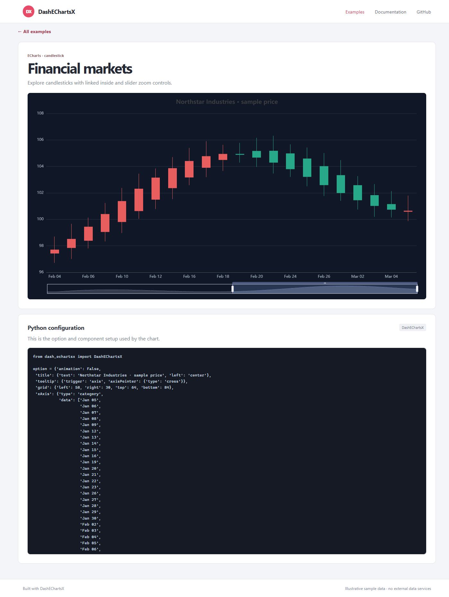
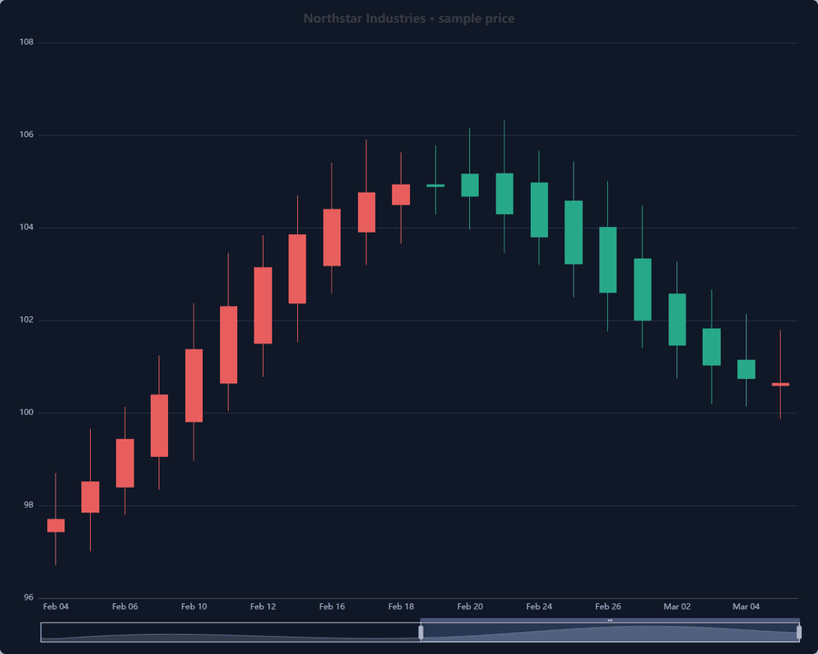
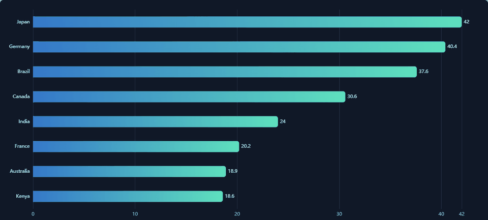

Usage guide
===========

Create a Dash app and provide a JSON-compatible ECharts option to
``DashEChartsX``:

.. code-block:: python

   from dash import Dash, html
   from dash_echartsx import DashEChartsX

   app = Dash(__name__)
   app.layout = html.Div(
       DashEChartsX(
           id="sales-chart",
           option={
               "title": {"text": "Quarterly sales"},
               "tooltip": {"trigger": "axis"},
               "xAxis": {
                   "type": "category",
                   "data": ["Q1", "Q2", "Q3", "Q4"],
               },
               "yAxis": {"type": "value"},
               "series": [
                   {"type": "bar", "name": "Sales", "data": [120, 200, 150, 80]}
               ],
           },
           style={"width": "100%", "height": "60vh", "aspectRatio": "auto"},
       ),
       style={"width": "90vw"},
   )

   An example detail page pairs an interactive chart with the Python setup
   used to create it.

Drag the candlestick chart's slider to change the visible date range:

   Zoom into the financial chart with its slider control.

The gallery also includes animated examples, such as this bar race:

   A short capture of the animated bar-race example.

The component supports canvas and SVG rendering, light and dark named themes,
custom maps, event callbacks, ECharts actions, incremental ``append_data``, and
optional ECharts-GL loading. See the :doc:`reference/python_api` and the
:doc:`reference/typescript_props` for the generated API details.

JavaScript formatter functions
------------------------------

Use ``js_function`` for options that require an ECharts callback. The helper
marks reviewed JavaScript source for explicit browser-side compilation:

.. code-block:: python

   from dash_echartsx.utils import js_function

   option = {
       "tooltip": {
           "formatter": js_function(
               "function(params) { return params.name + ': ' + params.value; }"
           )
       }
   }

Marked source is executable code, not a sandboxed expression. Never build it
from user input or other untrusted data. Compilation requires a Content Security
Policy that allows ``unsafe-eval``.
